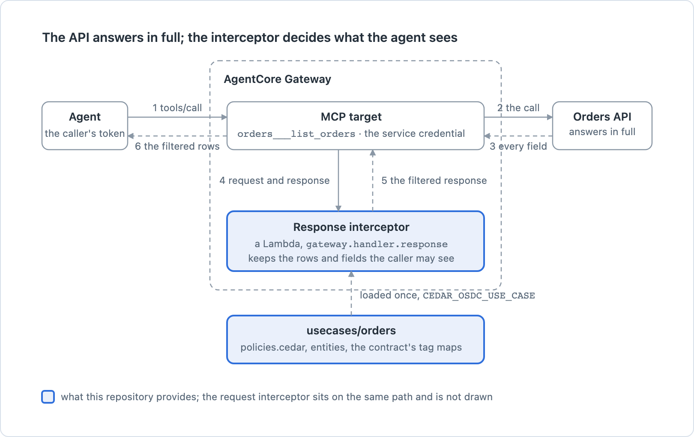
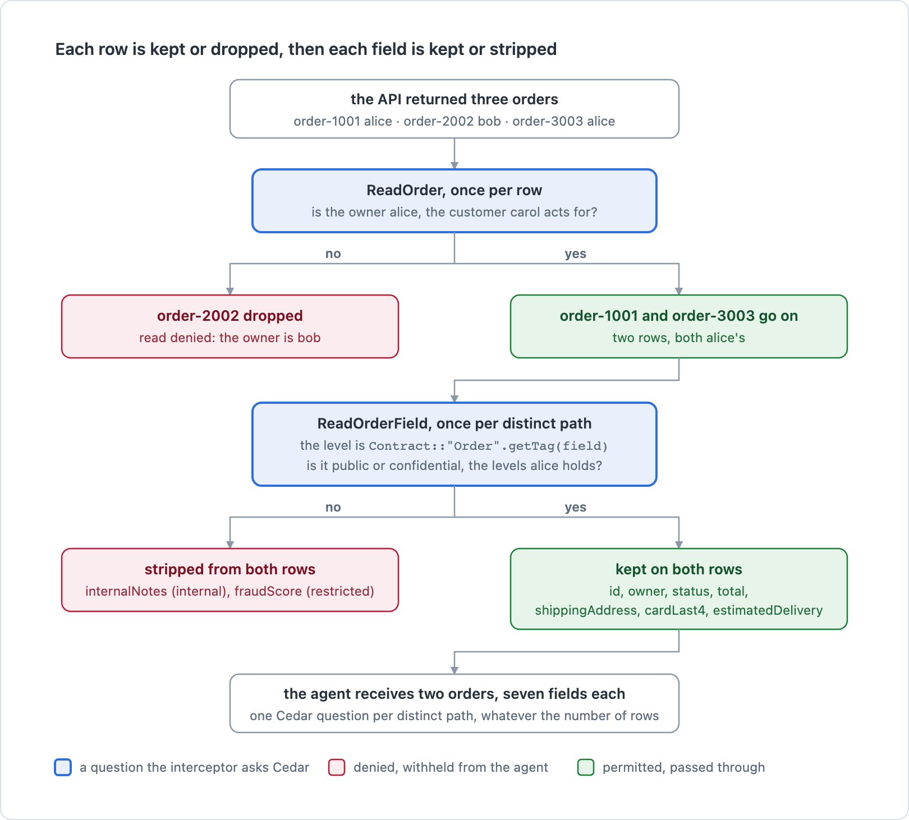
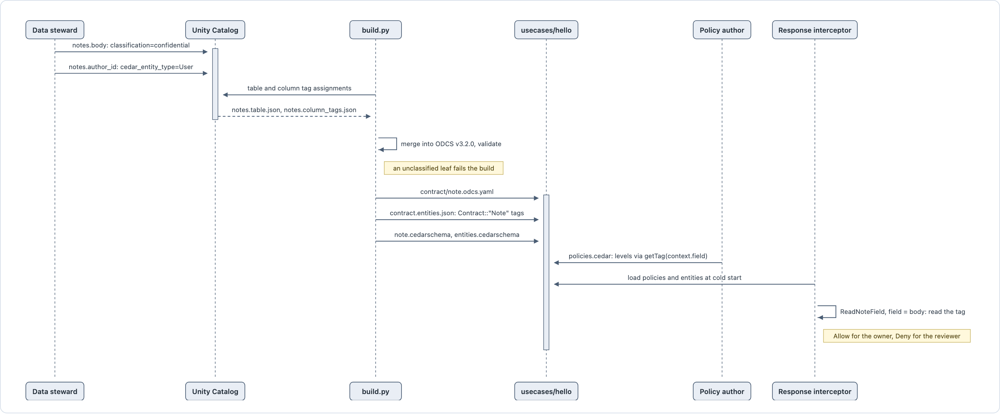

# cedar-odcs

Data governance for an agent's tool calls. The agent reaches an API through an MCP tool in AgentCore Gateway with a service credential, so the API answers whatever is asked; two Gateway interceptors decide every call with [Cedar](https://docs.cedarpolicy.com/) policies instead. What a field means and who may see it come from the data contract, generated from the catalog. A use case is a folder with four things, a data contract, policies, tests, and guardrails; one command checks the folder; the same folder is what the Gateway loads.

## The Gateway and the response interceptor

The agent never holds the API's credential. The Gateway makes the call with a service credential, so the API answers with every field of every record; the response interceptor, a Lambda the Gateway invokes before the result leaves, keeps the rows the caller may read and the fields the caller may see. The request interceptor sits on the same path before step 2 and is not drawn here.



## One list response through the response leg

Carol is a support specialist acting for the customer alice. The list tool returns three orders, one of them bob's. The row round asks Cedar `ReadOrder` once per row and drops bob's; the field round asks `ReadOrderField` once per distinct path, and the policy looks the path up in the contract's classification map. Alice's grant covers public and confidential, so the internal and restricted fields are stripped from the rows that survive.



The same case from the command line, with the three orders as the response:

```sh
uv run cedar-odcs dry-run usecases/orders --caller usecases/orders/tests/identities/carol-for-alice.json --tool orders___list_orders --response usecases/orders/tests/lists/orders.json
```

## From catalog tags to a policy decision

A policy never names a field. The data steward classifies columns in Unity Catalog; the build turns the catalog's answers into an ODCS data contract and then into a Cedar entity whose tags map each field path to its level; the policy grants levels and reads the tag at decision time. Changing a column's classification in the catalog and rebuilding changes what every policy permits, with no policy edited.



## What you can do

Clone, then from the repository root with [uv](https://docs.astral.sh/uv/) installed:

```sh
uv sync
```

**Check a use case.** Build its contract, validate its policies, run its tests, prove its guardrails:

```sh
uv run cedar-odcs check usecases/hello
```

The first three gates need Python only. The fourth, the proofs, needs Rust and the cvc5 solver; without them it prints the install steps and the command exits 1. `analysis/README.md` says how to get them. Validation uses the cedarpy binding unless the official `cedar` command is on the path.

**See what a caller may do.** Every verb, every readable field, every writable field, from real authorization questions:

```sh
uv run cedar-odcs check-access usecases/orders --caller usecases/orders/tests/identities/carol.json
```

**Put one tool call through both legs without calling the tool.** The request leg decides the verb and the payload; the response leg strips what the caller may not see:

```sh
uv run cedar-odcs dry-run usecases/hello --caller usecases/hello/tests/identities/rae.json --tool notes___get_note --arg noteId=note-1 --response usecases/hello/tests/responses/note-1.json
```

**Open a case in Cedar's playground.** The policies, the entities, and the request, pre-filled:

```sh
uv run cedar-odcs share usecases/hello --case "rae may not read the body"
```

**Check everything.** The tests, the four gates on each use case, and the proofs of the history chain:

```sh
./check.sh
```

**Learn it in three steps**, each a use case you can run, change, and break: [the learning path](learn/index.html). It begins where Cedar's own tutorial ends. The pages under `learn/` and `history/` are self-contained HTML; open them from a clone in a browser.

**Start a use case of your own.** [The guide](learn/guide.html) says what to know about your domain, what each file in the folder is for, and the three policy shapes to copy from.

**Read how it was built.** [The history](history/index.html): fifteen iterations, each a design narrative, and the nine snapshots as they were.

## The repository

| Directory | What it holds |
|---|---|
| `usecases/` | one folder per domain: hello, orders, reservations |
| `cedar_odcs/` | the tool: the engine, the command line, the Gateway handlers |
| `analysis/` | the symbolic analysis runner that proves guardrails, and the history chain |
| `learn/` | the learning path, the guide, and the page on proofs |
| `designs/` | the plan the current layout came from, and plans for work not yet done |
| `history/` | how it was built |
| `images/` | the README's diagrams, their source page, and the script that renders them |
| `AGENTS.md`, `CLAUDE.md`, `.beads/` | issue tracking for the agents that built this; not needed to run it |
